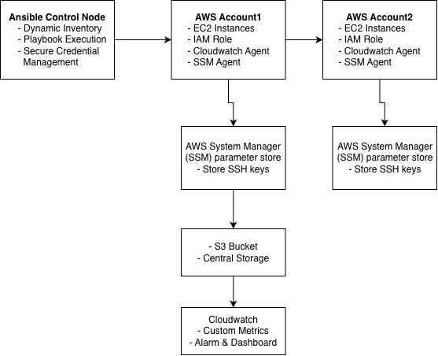

# Scalable Multi-Account Disk Monitoring Solution for AWS

An enterprise-grade, zero-trust solution to monitor disk space and inode utilization across multi-account AWS environments using **Ansible**, **AWS Systems Manager (SSM)**, and **Amazon CloudWatch Cross-Account Observability (OAM)**.

## Table of Contents
1. [Overview](#overview)
2. [Architecture](#architecture)
3. [Key Features](#key-features)
4. [Repository Structure](#repository-structure)
5. [Setup & Installation](#setup--installation)
6. [Usage & Operations](#usage--operations)
7. [Scalability & Design Trade-offs](#scalability--design-trade-offs)
8. [Security & Compliance](#security--compliance)
9. [Contact](#contact)

---

## Overview
As enterprises scale through acquisitions, fragmented AWS accounts and unmonitored virtual machines create a high risk of sudden disk-full outages. This solution leverages **Ansible** as a centralized configuration orchestrator over **AWS Systems Manager (SSM)** to discover instances, deploy the **Amazon CloudWatch Agent**, and enforce standardized alerting across all AWS accounts—without bastion hosts, open SSH ports, or static credentials.

---

## Architecture


### End-to-End Data Flow
1. **Multi-Account Discovery:** The dynamic inventory script (`inventory/aws_inventory.py`) uses AWS STS `AssumeRole` to query EC2 instances across member and newly acquired AWS accounts.
2. **Zero-SSH Orchestration:** Ansible connects to target VMs over **AWS SSM Session Manager** (no inbound port `22`/`3389` or SSH keys required) to install and configure the Unified CloudWatch Agent (`playbooks/deploy_cloudwatch_agent.yml`).
3. **Asynchronous Metric Push:** Each VM pushes `disk_used_percent` and `inodes_free` metrics directly to CloudWatch over private AWS endpoints, preventing Ansible controller bottlenecks.
4. **Central Aggregation & Alerting:** **CloudWatch Cross-Account Observability (OAM)** streams metrics from all workload accounts into a single Central Monitoring Account, triggering tiered alarms (`templates/cloudwatch_alarm.yml.j2`) via SNS/Slack/PagerDuty.

---

## Key Features
- **Multi-Account Support:** Uses cross-account IAM `AssumeRole` for fleet discovery and CloudWatch OAM for centralized dashboards and alerting.
- **Zero-SSH Access Management:** Eliminates SSH key distribution and bastion hosts by routing Ansible execution exclusively through AWS Systems Manager (SSM).
- **Proactive Disk & Inode Telemetry:** Monitors both block storage capacity (`disk_used_percent`) and inode exhaustion (`inodes_free`), excluding ephemeral filesystems (`tmpfs`, `devtmpfs`).
- **Automated Alarm Provisioning:** Deploys standardized CloudWatch alarms with both `AlarmActions` and `OKActions` for automated incident recovery notifications.
- **Cloud-Agnostic Extensibility:** Modular Ansible playbook design allows straightforward extension to **Azure** (Azure Monitor Agent + Dynamic Inventory) and **GCP** (Ops Agent).

---

## Repository Structure
```text
disk-monitoring-solution/
├── doc/
│   └── architecture.png                # High-level multi-account architecture diagram
├── inventory/
│   └── aws_inventory.py                # Cross-account dynamic EC2 discovery script
├── playbooks/
│   ├── deploy_cloudwatch_agent.yml     # Installs & configures CloudWatch Agent via SSM
│   └── disk_monitoring.yml             # Validates disk thresholds & provisions CloudWatch alarms
├── templates/
│   ├── cloudwatch_alarm.yml.j2         # Parameterized CloudWatch alarm definition
│   └── iam_policy.json                 # Least-privilege IAM policy for Ansible & target VMs
├── LICENSE
└── README.md
```

---

## Setup & Installation

### Prerequisites
1. **AWS Accounts & IAM:**
   - **Central Monitoring Account:** Configured as a CloudWatch OAM monitoring sink with an SNS Topic (`DiskAlertTopic`) for alert routing.
   - **Workload / Acquired Accounts:** IAM roles configured using `templates/iam_policy.json` trusting the central Ansible control role, plus `AmazonSSMManagedInstanceCore` attached to EC2 instance profiles.
2. **Ansible Control Node:**
   - Python 3.8+, `ansible`, `boto3`, `botocore`, and `aws-cli`.
   - Instance profile or IAM credentials authorized to call `sts:AssumeRole` across member accounts.

### Step-by-Step Deployment

1. **Clone the Repository**
   ```bash
   git clone https://github.com/akshaymarkad2/disk-monitoring-solution.git
   cd disk-monitoring-solution
   ```

2. **Configure IAM Permissions**
   Attach `templates/iam_policy.json` to the Ansible execution role in target accounts and ensure target EC2 instances have SSM and CloudWatch permissions enabled.

3. **Generate Multi-Account Dynamic Inventory**
   ```bash
   python3 inventory/aws_inventory.py > inventory.ini
   ```

4. **Deploy & Configure CloudWatch Agent Across Fleet**
   ```bash
   chmod +x inventory/aws_inventory.py
   export AWS_ACCOUNT_IDS="111122223333,444455556666"
   export AWS_REGION="us-east-1"

   ansible-playbook -i inventory/aws_inventory.py playbooks/deploy_cloudwatch_agent.yml
   ```

5. **Enforce Disk Thresholds & Provision CloudWatch Alarms**
   ```bash
   ansible-playbook -i inventory/aws_inventory.py playbooks/disk_monitoring.yml
   ```

---

## Usage & Operations

### 1. Automated Day-1 Onboarding & Drift Remediation
Schedule periodic configuration runs via **AWS Systems Manager State Manager** (or cron on the Ansible controller) to ensure newly launched VMs automatically receive the monitoring configuration:
```bash
0 */6 * * * cd /opt/disk-monitoring-solution && AWS_ACCOUNT_IDS="111122223333,444455556666" AWS_REGION="us-east-1" /usr/local/bin/ansible-playbook -i inventory/aws_inventory.py playbooks/deploy_cloudwatch_agent.yml >> /var/log/disk_monitoring_cron.log 2>&1
```

### 2. Centralized Visibility
- **Metrics:** Open the Central Monitoring Account in the AWS Console → **CloudWatch → Metrics → CWAgent / DiskMonitoring**.
- **Alarms:** Navigate to **CloudWatch → Alarms** to inspect `HighDiskUsage-*` thresholds (Warning at `75%`, Critical at `85%`).

### 3. Alert Notifications
- **SNS Integration:** Triggers real-time notifications to Email, Slack, or PagerDuty on `ALARM` state and automatically resolves tickets on `OK` state.

---

## Scalability & Design Trade-offs
- **Why Agent-Push + SSM over SSH Polling?** Polling thousands of VMs via SSH `df -h` creates severe Ansible controller bottlenecks, lacks historical trend data for capacity planning, and requires managing SSH keys across acquired networks. Using Ansible to deploy a lightweight push agent decouples data collection from configuration management, scaling horizontally from 100 to 50,000+ VMs.
- **M&A Account Onboarding:** New AWS accounts joined to AWS Organizations can be onboarded automatically via CloudFormation StackSets to deploy the baseline IAM roles and CloudWatch OAM source links.

---

## Security & Compliance
- **Least-Privilege IAM:** Scoped permissions in `templates/iam_policy.json` restricted to required EC2, SSM, and CloudWatch actions.
- **Zero Inbound Exposure:** All management traffic runs over AWS SSM endpoints; no SSH/WinRM ports are exposed.
- **Encryption in Transit:** All telemetry and SSM control-plane traffic is encrypted via TLS 1.2+ (and optionally routed over AWS PrivateLink VPC Endpoints).
- **Auditability:** Every cross-account `AssumeRole` and SSM command execution is logged in **AWS CloudTrail**.
- **Tag-Based Governance:** Scopes execution to instances tagged `Monitor: true`.

---

## Contact
- **Name:** Akshay Markad
- **Email:** akshay.markad2@gmail.com
